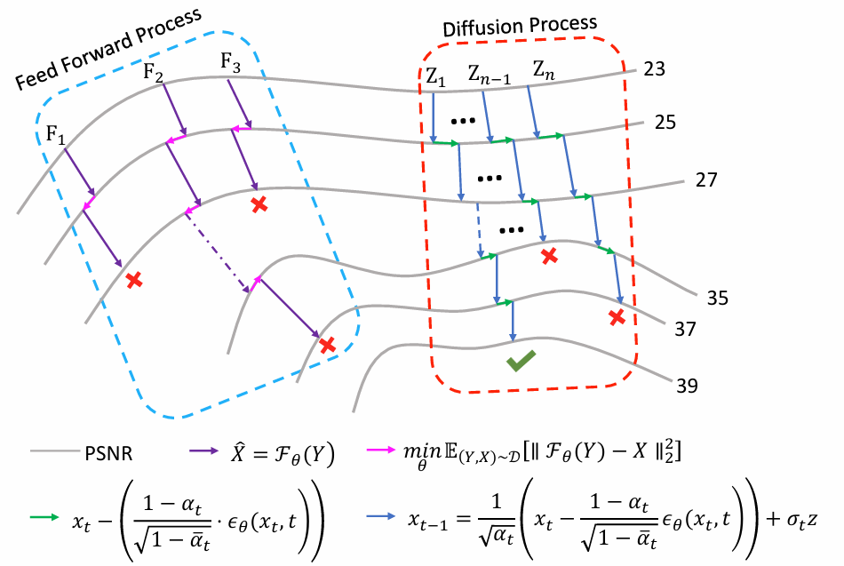

# Degradation-Adaptive Denoising: Aligning Diffusion Models with Physics of Video Snapshot Compressive Imaging

**Authors:** Mingjin Zhang, Mingrui Li, Jie Guo, Yunsong Li

[Paper (IEEE Xplore)](https://ieeexplore.ieee.org/abstract/document/11526936/) | [MIT License](LICENSE)

## Abstract

Video Snapshot Compressive Imaging (SCI) captures multiple video frames in a single exposure, enabling efficient reconstruction of high-speed scenes for motion analysis and event detection. Existing SCI in coded aperture compressive temporal imaging (CACTI) methods predominantly rely on feedforward deep networks with fixed denoising strategies. However, they lack alignment with the SCI physical inverse model and struggle to balance motion detail recovery and static background smoothing. In this paper, we propose PCD-Diffusion for Video SCI, the first diffusion-based reconstruction framework for Video SCI, which reformulates the inverse problem as a progressive denoising process. Specifically, we design a Physically-Constrained Dynamic Diffusion (PCD-Diffusion) model, introducing a region-adaptive diffusion schedule and spatiotemporal residual estimation. This method explicitly aligns the denoising process with SCI’s spatially non-uniform and temporally evolving residual distribution. Additionally, a motion prior-guided diffusion schedule and a Gauss-guided spatiotemporal adaptive residual estimation dynamically steer the denoising trajectory, ensuring accurate motion detail restoration and physically consistent reconstructions. Extensive results on simulated and real datasets verify the superior reconstruction fidelity and temporal coherence of the proposed PCD-Diffusion framework over existing approaches. Code will be released upon publication.



**Figure 1.** Compared to feedforward networks, diffusion methods can progressively explore the entire reconstruction solution space during the denoising process due to mathematical properties, leading to better reconstruction performance.

## Training

The `train` command starts model training using DAVIS video frames and a fixed mask. Run it from the repository root. Replace every `""` below with the appropriate path, keeping the quotation marks. Relative paths are resolved from your current working directory.

```powershell
python -m pcd_diffusion train --config "" --data "" --split-file "" --mask "" --output "" --device cuda
```

| Argument | What to put between the quotation marks |
| --- | --- |
| `--config` | Training configuration JSON: `configs/prior_token_starter.json` for a smaller starting configuration, or `configs/prior_token_gray.json` for the larger grayscale configuration. |
| `--data` | DAVIS frame directory containing one subdirectory per video sequence, e.g. `data/DAVIS/JPEGImages/480p`. |
| `--split-file` | Training split text file with one sequence name per line, e.g. `data/DAVIS/ImageSets/2017/train.txt`. |
| `--mask` | MATLAB mask file containing the `mask` array with shape `[H, W, N]`, e.g. `data/masks/random_mask.mat`. |
| `--output` | Directory for training checkpoints and logs, e.g. `runs/train`. The directory is created if needed. |

The command-line `--mask` and `--split-file` values override the empty values in the configuration. Training saves `last.pt` directly inside the output directory.

## Testing / Evaluation

The `evaluate-six-gray` command loads a trained checkpoint and evaluates reconstruction quality on the six grayscale benchmark sequences. It reports PSNR and SSIM; it does not train the model.

```powershell
python -m pcd_diffusion evaluate-six-gray --checkpoint "" --root "" --mask "" --output "" --device cuda
```

| Argument | What to put between the quotation marks |
| --- | --- |
| `--checkpoint` | Trained checkpoint file, e.g. `runs/train/last.pt`. |
| `--root` | Directory containing the six benchmark MAT files, e.g. `data/six_gray`. The files are `aerial32_cacti.mat`, `crash32_cacti.mat`, `drop8_cacti.mat`, `kobe_cacti.mat`, `runner8_cacti.mat`, and `traffic_cacti.mat`. |
| `--mask` | Fixed benchmark MATLAB mask file, e.g. `data/masks/random_mask.mat`. |
| `--output` | Output JSON report file, e.g. `runs/test_metrics.json`. This is a file path, unlike the training output directory. |

Both commands use `--device cuda` for an NVIDIA GPU. Change it to `--device cpu` to run on the CPU. The paths above are examples; datasets and trained checkpoints must be provided separately.

## Citation

If you find this work useful, please cite:

```bibtex
@article{zhang2026degradation,
  author={Zhang, Mingjin and Li, Mingrui and Guo, Jie and Li, Yunsong},
  journal={IEEE Transactions on Image Processing},
  title={Degradation-Adaptive Denoising: Aligning Diffusion Models With Physics of Video Snapshot Compressive Imaging},
  year={2026},
  volume={35},
  pages={5409--5422},
  doi={10.1109/TIP.2026.3693121}
}
```
